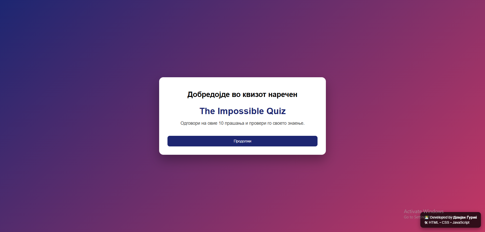
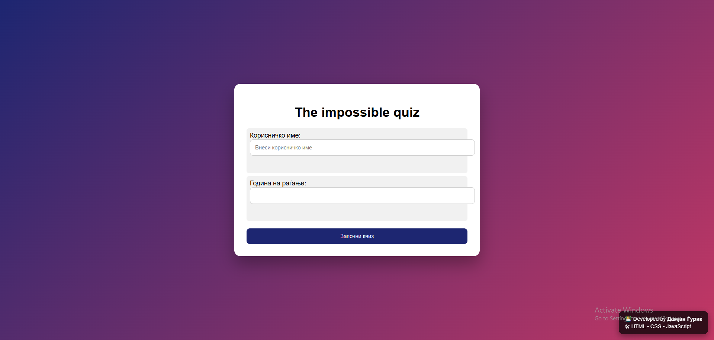
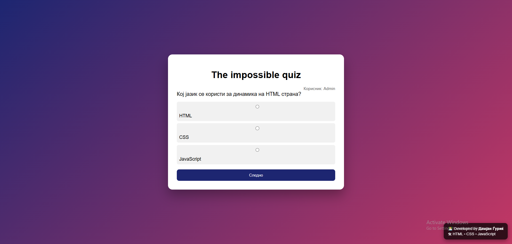
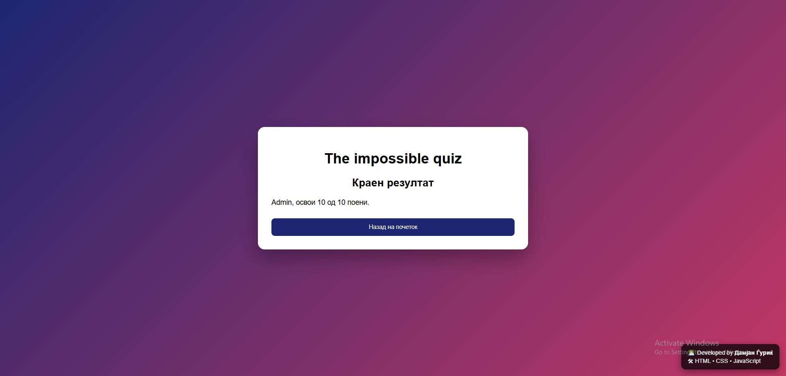

# 📝 Quiz
Quiz is a web application for solving questions and testing your knowledge. This project is made as a school project in order to improve my web programming skills.

---

## 📌 Main features

- User registration and login
- Multiple quiz categories
- Randomized questions
- Automatic score calculation
- Result history
- User-friendly interface
- Database support

---

## 🛠 Used Technologies

- HTML5
- CSS3
- JavaScript
- PHP
- MySQL
- XAMPP

---

## 📷 Screenshots

### 🏠 Home Page



---
### 💻 Enter Data



---

### ❓ Questions



---

### ✅ Final result



---

## ⚙ Installation

1. Copy the repository.
2. Paste it to xampp/htdocs.
3. Start Apache and MySQL through XAMPP.
4. Import the database kviz_podatoci.sql to phpMyAdmin.
5. Open:
http://localhost/Quiz

---

## 📂 Project Structure

```text
Quiz
│
├── Database/
│   └── kviz_podatoci.sql
│
├── Screenshots/
│   ├── enter-data.png
│   ├── Final-result.png
│   ├── Home-page.png
│   └── Questions.png
│
├── Source/
│   ├── Index.html
│   ├── insert.php
│   ├── Script.js
|   └── Style.css
│
├── README.md
└── LICENSE
```

---

## 👨‍💻 Author

Damjan Gjurik
